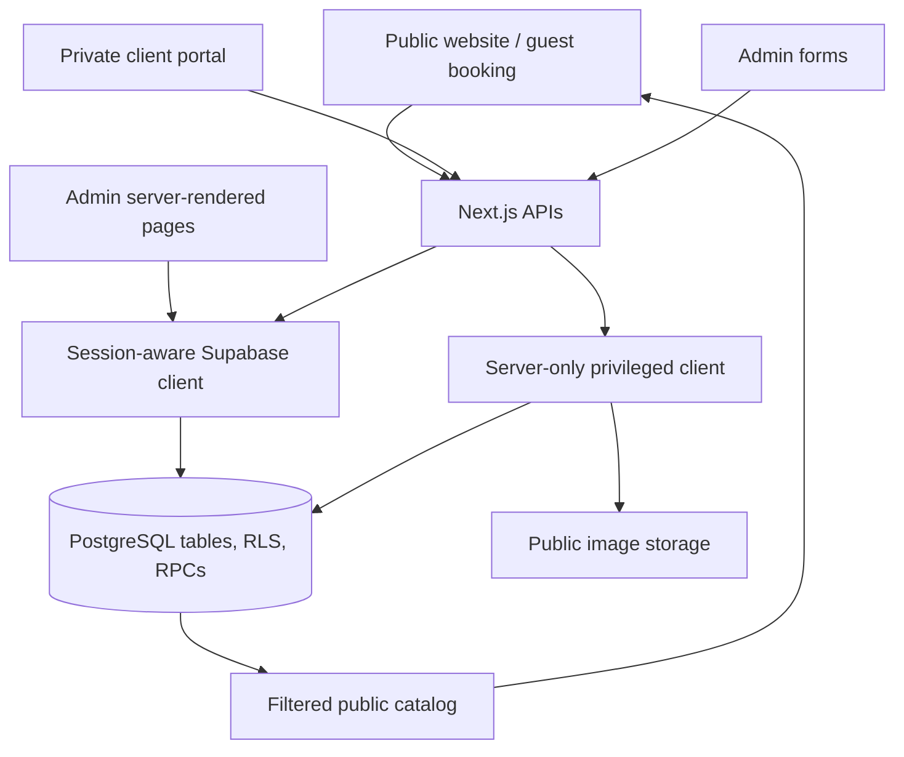
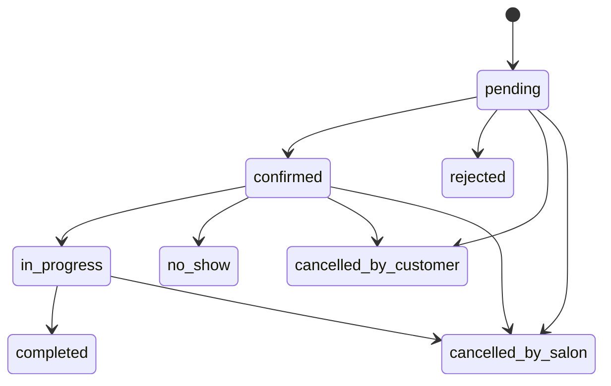
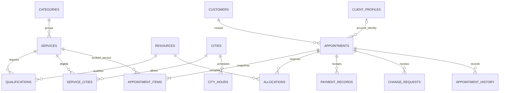

# Admin panel system reference

> **Baseline before the admin simplification:** the navigation and forms described here have since been consolidated. See [the current simplification guide](ADMIN_SIMPLIFICATION.md) for the five-section interface and additive migration 019. The underlying booking/security architecture remains applicable.

Reviewed against the repository on **12 November 2026**.

This guide describes the current **Fatu Makeup Artist** admin panel: what each screen does, which information it changes, how the booking system works, and where to make future modifications. The directory is still named `gelin_house_example`, and parts of the database and code retain GELIN HOUSE names for compatibility.

This is a source-code review, not verification of a connected production installation. Database behavior below assumes **all migrations through `202611110018_fatu_client_operations.sql` have been applied**. No live database, credentials, hosting configuration, or customer records were inspected or changed to prepare this guide.

## Contents

1. [System overview](#1-system-overview)
2. [Real administration and development preview](#2-real-administration-and-development-preview)
3. [Accounts, login, and permissions](#3-accounts-login-and-permissions)
4. [Complete navigation and route map](#4-complete-navigation-and-route-map)
5. [Dashboard and statistics](#5-dashboard-and-statistics)
6. [Bookings and appointment lifecycle](#6-bookings-and-appointment-lifecycle)
7. [Scheduling, cities, and capacity](#7-scheduling-cities-and-capacity)
8. [Client directory and privacy](#8-client-directory-and-privacy)
9. [Website management and editable fields](#9-website-management-and-editable-fields)
10. [Business settings](#10-business-settings)
11. [Requests, payments, messages, and notifications](#11-requests-payments-messages-and-notifications)
12. [Uploads and image storage](#12-uploads-and-image-storage)
13. [Languages and translations](#13-languages-and-translations)
14. [How changes are saved and published](#14-how-changes-are-saved-and-published)
15. [Database structure](#15-database-structure)
16. [API reference](#16-api-reference)
17. [Security and data integrity](#17-security-and-data-integrity)
18. [Setup and daily operation](#18-setup-and-daily-operation)
19. [Current limitations and review points](#19-current-limitations-and-review-points)
20. [Where to modify the system](#20-where-to-modify-the-system)
21. [Verification and related documents](#21-verification-and-related-documents)

## 1. System overview

The application has three connected areas:

| Area                    | Main address | Purpose                                                                                                                 |
| ----------------------- | ------------ | ----------------------------------------------------------------------------------------------------------------------- |
| Public website          | `/`          | Show services, portfolio, offers, biography, FAQ, policies, and contact details; accept booking requests and enquiries. |
| Administrator workspace | `/admin`     | Manage bookings, clients, website content, scheduling, receipts/refunds, access, and operations.                        |
| Private client portal   | `/client`    | Let signed-in clients view their own appointments, maintain their profile, and request changes.                         |

A guest can book without an account. A private management link gives access to that booking. Account ownership and guest-link possession are separate access mechanisms.

The admin panel combines a booking operations tool, a small client directory, a structured website content manager, and a manual payment ledger. It does not currently provide online payment processing or automatic booking-message delivery.

### Technology and responsibility

| Layer                 | Implementation                                    | Responsibility                                                                  |
| --------------------- | ------------------------------------------------- | ------------------------------------------------------------------------------- |
| Application framework | Next.js App Router, React, TypeScript             | Pages, server rendering, forms, and API routes.                                 |
| Styling               | Tailwind CSS dependency plus application CSS      | Public and admin layouts, responsive behavior, visual identity.                 |
| Validation            | Zod                                               | Validate incoming fields, selections, contact details, dates, and identifiers.  |
| Time calculations     | Temporal polyfill and `Intl`                      | Business timezone conversions, date windows, localized display.                 |
| Identity              | Supabase Auth with SSR cookies                    | Sign-in, recovery, invitations, session validation.                             |
| Business database     | Supabase PostgreSQL                               | Bookings, website content, schedules, reporting, permissions, and transactions. |
| Images                | Supabase Storage and Sharp                        | Decode, optimize, and store approved public media.                              |
| Verification          | Vitest, Playwright, disposable PostgreSQL scripts | Unit/API, browser, and database checks.                                         |

`package.json` declares Next.js `^16.4.6`, React `^19.3.1`, TypeScript `6.0.3`, and Node.js `>=24`. Use the lockfile for the installed dependency versions.



RPC means a database function called by the application. Many important business rules live in SQL functions rather than React components.

## 2. Real administration and development preview

These are two different operating modes.

| Behavior                             | Real admin                                  | Development preview                                  |
| ------------------------------------ | ------------------------------------------- | ---------------------------------------------------- |
| Entry                                | `/admin/login`, then `/admin`               | `/admin/preview`                                     |
| Authentication                       | Active admin account required               | Available without a real account in development.     |
| Storage                              | Supabase PostgreSQL                         | Browser `localStorage`, key `fatu-admin-preview-v1`. |
| Content changes                      | Save real database records                  | Save content only in that browser and origin.        |
| Public website affected              | Yes, subject to publication rules           | No.                                                  |
| Bookings, receipts, access, delivery | Real connected operations                   | No operational simulation of these workflows.        |
| Dashboard                            | Database reporting                          | Zero/empty operational statistics.                   |
| Calendar                             | Database appointments and schedule overlays | Empty layout preview with date/view navigation.      |
| Production availability              | Yes, if configured                          | Returns 404.                                         |

Preview navigation uses query parameters, for example `/admin/preview?section=services`. A reset button asks for confirmation and restores the preview seed. Clearing browser storage also removes local edits. Browser validation is present, but PostgreSQL relationship, scheduling, publication, and transaction checks are not exercised by preview saves.

In preview, the clients section uses the generic guest-contact editor. The real `/admin/clients` page uses the richer account/guest directory. Preview therefore cannot demonstrate every real screen's behavior.

Source: [`fatu-preview.tsx`](../src/components/fatu-preview.tsx), [`preview/page.tsx`](../src/app/admin/preview/page.tsx), [`proxy.ts`](../src/proxy.ts).

## 3. Accounts, login, and permissions

### Administrator access

1. The administrator signs in with email and password at `/admin/login`.
2. Supabase validates the credentials.
3. The application calls `auth.getUser()` and checks the matching `admin_profiles` record.
4. Access is granted only when that profile exists and `active = true`.
5. Protected pages redirect unauthorized visitors to `/admin/login`. Protected APIs reject unauthorized actions.

Every active administrator has the **same complete application access**, including content, bookings, financial records, privacy actions, and administrator invitations. There is no current owner/manager/receptionist permission selector.

The database stores the legacy role value `owner` for all administrators. Migration 008 normalizes existing roles and adds a constraint enforcing this single value. Old function names such as `requireStaff()`, `staff_role()`, and `owner_update_access()` remain in use; their names do not establish separate current permission levels.

### Three kinds of person must remain distinct

| Record                          | Meaning                                         | Automatically gets admin access?    |
| ------------------------------- | ----------------------------------------------- | ----------------------------------- |
| `admin_profiles`                | A person authorized to use the admin workspace. | Yes, when active and authenticated. |
| `resources` with `kind = staff` | An artist/provider who can perform a service.   | No.                                 |
| `client_profiles`               | A signed-in customer profile.                   | No.                                 |

A provider can be scheduled without a login. Inviting an administrator does not automatically create or qualify a provider resource.

### Access management: `/admin/team`

- Invite using a display name and email address.
- The server sends a Supabase Auth invitation, then inserts the admin profile and records an audit event.
- Existing administrators can be activated or deactivated.
- The final active administrator cannot be deactivated (`LAST_OWNER`).
- Deactivation prevents subsequent authorized operations even if an old Auth session still exists.
- The page loads up to 100 administrator profiles; it has no pagination.

Invitations depend on working Supabase email configuration. Auth invitation and profile creation happen in separate service calls, so a failure between them is an operational recovery case; the UI does not provide a full invitation-repair workflow.

### Recovery and passwords

| Address           | Purpose                                                                 |
| ----------------- | ----------------------------------------------------------------------- |
| `/admin/reset`    | Request a recovery email; response does not disclose account existence. |
| `/auth/callback`  | Verify supported email tokens or exchange an Auth code for a session.   |
| `/admin/password` | Set/update a password for an authorized admin session.                  |

New passwords must contain 12–128 characters. Callback destinations are allowlisted; the default is `/admin/password`. Logout calls Supabase sign-out and returns to the login page. Auth action endpoints use a limit of six attempts per minute per configured rate-limit identity and action.

Source: [`auth.ts`](../src/lib/auth.ts), [`team.tsx`](../src/components/team.tsx), [`auth API`](../src/app/api/auth/[action]/route.ts), migration `202611110008_single_admin.sql`.

## 4. Complete navigation and route map

The sidebar is grouped into business, website, studio, and administration sections. It becomes a toggleable menu on smaller screens. The shell includes the current admin's name, initial avatar, language switcher, public-site link, and logout.

| Screen                          | Route                     | Main source/data                                         |
| ------------------------------- | ------------------------- | -------------------------------------------------------- |
| Overview                        | `/admin`                  | `fatu_admin_summary` RPC.                                |
| Bookings                        | `/admin/bookings`         | `fatu_search_bookings` RPC.                              |
| Calendar                        | `/admin/calendar`         | Appointment search plus hours, exceptions, and closures. |
| Clients                         | `/admin/clients`          | `fatu_clients` RPC.                                      |
| Services                        | `/admin/services`         | `services`.                                              |
| Categories                      | `/admin/categories`       | `categories`.                                            |
| Portfolio                       | `/admin/portfolio`        | `gallery`.                                               |
| Reviews                         | `/admin/reviews`          | `reviews`.                                               |
| Promotions                      | `/admin/promotions`       | `promotions`.                                            |
| Promotion eligibility           | `/admin/eligibility`      | `promotion_services`.                                    |
| Website content                 | `/admin/content`          | `website_content`.                                       |
| Translations                    | `/admin/translations`     | `translations`.                                          |
| FAQ                             | `/admin/faqs`             | Also `website_content`; FAQ keys need `faq.` prefix.     |
| Locations/cities                | `/admin/locations`        | `cities`.                                                |
| City hours                      | `/admin/city-hours`       | `city_hours`.                                            |
| Weekly availability             | `/admin/availability`     | `working_hours`.                                         |
| Exceptional hours               | `/admin/exceptions`       | `opening_exceptions`.                                    |
| Equipment per service           | `/admin/resources`        | `service_resources` association table.                   |
| Closures and absences           | `/admin/closures`         | `closures`.                                              |
| Providers and equipment records | `/admin/staff`            | `resources`, both kinds.                                 |
| Qualifications                  | `/admin/qualifications`   | `qualifications`.                                        |
| Service-city eligibility        | `/admin/service-cities`   | `service_cities`.                                        |
| Client change requests          | `/admin/requests`         | `change_requests`.                                       |
| Payments and refunds            | `/admin/payments`         | `payment_records`.                                       |
| Contact messages                | `/admin/messages`         | `contact_messages`.                                      |
| Notification events             | `/admin/notifications`    | `notification_outbox`.                                   |
| Settings                        | `/admin/settings`         | Singleton `salon_settings` row, ID `1`.                  |
| Administrator access            | `/admin/team`             | `admin_profiles` and Supabase Auth.                      |
| Activity                        | `/admin/activity`         | `audit_logs`.                                            |
| New manual booking              | `/admin/appointments/new` | Shared city-aware booking flow.                          |

Compatibility addresses still exist: `/admin/appointments` uses the same page as `/admin/bookings`; `/admin/gallery` and `/admin/portfolio` manage the same table; `/admin/offers` and `/admin/promotions` manage the same table. `/admin/customers` remains a generic contact editor, whereas `/admin/clients` has its own specialized page.

Unknown entity pages return 404 after authentication. Sidebar definitions are in [`admin-navigation.tsx`](../src/components/admin-navigation.tsx).

## 5. Dashboard and statistics

The overview defaults to the current calendar month in the configured business timezone. From/to filters use full local days, converted to UTC instants for database queries. The end date is inclusive in the form and exclusive at the next day's midnight in SQL.

**The date filter does not affect every dashboard card.** This is the actual reporting scope:

| Figure                | Calculation                                                                       | Selected date range?              |
| --------------------- | --------------------------------------------------------------------------------- | --------------------------------- |
| Bookings              | Appointment count by appointment start.                                           | Yes.                              |
| Pending               | All appointments with `pending` status.                                           | No.                               |
| Clients               | All client profiles plus customer records with guest appointments.                | No.                               |
| Completed             | Completed appointments by appointment start.                                      | Yes.                              |
| Cancelled             | Customer cancellations, salon cancellations, and rejections by appointment start. | Yes.                              |
| Booking value         | Sum of pending, confirmed, in-progress, and completed appointment totals.         | Yes, by appointment start.        |
| Paid                  | Payments minus refunds, grouped by currency.                                      | Yes, by receipt-record timestamp. |
| Popular services      | Top five item snapshot names by count, excluding cancelled/rejected appointments. | Yes, by appointment start.        |
| Upcoming appointments | Next eight active appointments whose end is still in the future.                  | No.                               |
| Requests              | Pending client requests.                                                          | No.                               |
| Messages              | Unhandled contact messages.                                                       | No.                               |
| Notifications         | Queued outbox events.                                                             | No.                               |

The cancelled figure excludes `no_show`. Popular-service reporting does not exclude `no_show`. Client count is a record count, not a deduplicated count of real people. Upcoming can include an appointment already in progress.

Money is grouped by currency; the system does not convert currencies. Confirming a booking does not record a payment. A payment entered today for a booking next month appears in this month's paid figure and next month's booking value. Starting/consultation prices can make booking value uncertain.

Source: [`dashboard page`](<../src/app/admin/(protected)/page.tsx>), [`dashboard component`](../src/components/fatu-admin-dashboard.tsx), migration `202611110012_fatu_reporting.sql`.

## 6. Bookings and appointment lifecycle

### Finding a booking

The bookings page supports combined filters for:

- Name, phone, or reference search, up to 100 characters.
- Start/end date, status, city, and service.
- A specific guest customer (`customer` query parameter).
- A specific client account (`client` query parameter).
- An exact booking reference (`reference` query parameter).

Results are ordered by appointment start and ID, with 50 per page. The normal date window is today through 30 days ahead. Customer, client, or reference history mode omits the date bounds so older bookings remain reachable; other filters still apply. Regular date ranges longer than 365 days or invalid ranges fall back to the default.

### Booking detail

The table shows reference, customer, city, service names, start time, status, and total. Expanding a row exposes:

- Contact phone/email, city, and event address.
- Customer booking notes and event details.
- Total and separately displayed travel fee; travel is already included in the total.
- End time and ordered service items.
- Each item's duration, start/end, saved price, promotion name, and assigned provider name.
- An editable private appointment note, up to 5,000 characters.
- Appointment history, loaded on demand, up to 200 entries.
- Allowed status transitions and rescheduling controls.

A single-result page opens the detail automatically. Appointment history is distinct from the general admin activity log.

### Status rules

| Current status          | Allowed next statuses                                                   |
| ----------------------- | ----------------------------------------------------------------------- |
| `pending`               | `confirmed`, `rejected`, `cancelled_by_customer`, `cancelled_by_salon`  |
| `confirmed`             | `in_progress`, `cancelled_by_customer`, `cancelled_by_salon`, `no_show` |
| `in_progress`           | `completed`, `cancelled_by_salon`                                       |
| `completed`             | None.                                                                   |
| `cancelled_by_customer` | None.                                                                   |
| `cancelled_by_salon`    | None.                                                                   |
| `rejected`              | None.                                                                   |
| `no_show`               | None.                                                                   |



The UI requires a reason for rejection and cancellation actions. SQL specifically enforces a reason when cancelling an appointment already in progress. The no-show transition is blocked until the start time plus `no_show_grace_minutes`.

Pending bookings **reserve capacity indefinitely until handled**; there is no automatic pending expiry. Terminal statuses release allocations and cannot be reopened through the supplied workflow. Completion records service completion, not receipt of money.

`reschedule_requested` is a display/filter condition derived from a pending reschedule request. It is not an additional stored appointment status.

### Manual booking

The new-booking action opens `/admin/appointments/new`, which reuses the public booking component in manual mode:

1. Select 1–10 distinct services from the shared basket/catalog.
2. Choose a city compatible with every selected service.
3. Enter event address and optional event details.
4. Choose date and an available start time.
5. Review the quote, travel fee, and any promotion code.
6. Enter name, valid phone, optional email/notes, and consent.
7. Save through `/api/admin/fatu-booking`.

The database creates a pending appointment, customer contact, ordered item snapshots, allocations, history, idempotency record, and booking-request notification event in one transaction. The receipt includes a reference and private management link.

The current Fatu manual route records source `other` and the acting admin; it does not offer a phone/WhatsApp/Instagram source selector. An older creation branch in `/api/admin/appointments` supports these source values but is not the current manual screen's submission path.

Manual booking obeys the same enabled-booking, published-service, notice, horizon, city, qualification, and availability constraints as public booking. It is not a scheduling override and does not automatically attach the appointment to a client account.

### Rescheduling

- Available for pending and confirmed appointments.
- Admin enters a local date/time; the form converts it using the configured business timezone.
- Availability and city rules are checked again in a database transaction.
- Failed changes roll back; the existing appointment and capacity remain intact.
- Existing service names, price snapshots, discounts, durations, buffers, travel fee, and currency remain recorded. Provider assignments and timing can change.
- Admin rescheduling preserves the existing pending/confirmed status.
- Direct guest rescheduling changes the booking to pending.
- Private management access expiry moves to 90 days after the revised end.

There is no current booking-detail form for replacing the service selection, editing its saved prices, selecting a different city/address, or manually choosing a provider. These would need explicit new workflows.

Sources: [`fatu-appointments.tsx`](../src/components/fatu-appointments.tsx), [`fatu-booking.tsx`](../src/components/fatu-booking.tsx), [`domain.ts`](../src/lib/domain.ts), migrations 002, 009, 010, and 011.

## 7. Scheduling, cities, and capacity

### Required pieces of a bookable appointment

```text
Approved business settings + booking enabled
  -> Published, bookable, non-archived service
  -> Published, non-archived category, if a category is assigned
  -> Active city eligible for every selected service
  -> City opening interval covering the appointment
  -> Global opening interval covering each service block
  -> Active qualified staff resource with covering hours
  -> Every required equipment resource active and available
  -> No overlapping closure or active resource allocation
  -> Start respects notice, booking horizon, and slot interval
```

Missing one layer can produce an empty availability result even when the calendar looks open.

### Providers, equipment, and qualifications

`/admin/staff` creates the resource itself: `name`, `kind` (`staff` or `equipment`), and `active`.

`/admin/qualifications` connects a staff resource to a service through `resource_id` and `service_id`. The scheduling engine selects an active qualified provider, ordered by resource UUID; it does not expose customer/admin provider selection in the current booking form.

`/admin/resources` connects a service to required equipment through `service_id` and `resource_id`. Despite the route name, it does not create equipment. Create equipment on `/admin/staff` first.

Each equipment record represents an exclusive physical unit. Linking multiple equipment records makes the service require all of them; it does not create a pool from which the engine selects one unit. Equipment also needs covering resource hours or exceptions.

### Scheduling editor fields

| Screen                   | Editable fields                                            | Interpretation                                                                            |
| ------------------------ | ---------------------------------------------------------- | ----------------------------------------------------------------------------------------- |
| Weekly availability      | `resource_id` (nullable), `weekday`, `opens`, `closes`     | Empty resource = global business hours; otherwise specific provider/equipment.            |
| Exceptional hours        | `resource_id` (nullable), `day`, `opens`, `closes`         | Replaces weekly hours for that scope/date.                                                |
| Closures                 | `resource_id` (nullable), `starts_at`, `ends_at`, `reason` | Empty resource = business-wide closure; otherwise absence/unavailability of one resource. |
| City hours               | `city_id`, `weekday`, `opens`, `closes`                    | Additional city constraint; does not replace global/resource schedules.                   |
| Service-city eligibility | `service_id`, `city_id`                                    | Permits a service in that city.                                                           |

Weekdays use `0 = Sunday` through `6 = Saturday`. A weekly/city interval must open before it closes; overnight rows are unsupported. Multiple rows allow split shifts and breaks. A service block must fit a covering interval; an appointment's city span must fit a city interval. Closures take precedence over opening exceptions.

Each service occupies `buffer_before + duration_minutes + buffer_after`. Multiple services run sequentially in selection order. For example, a 60-minute service with 15-minute preparation and 10-minute cleanup occupies 85 minutes. Adjacent allocations can touch at the end/start boundary without overlapping.

### Existing-booking protection

Schedule mutations run conflict checks against active future bookings. A closure overlapping allocated capacity is rejected. Resource/qualification/hour/equipment changes cannot silently make a scheduled appointment impossible. City deactivation, city-hour edits, eligibility removal, and timezone changes have additional guards.

The application returns `EXISTING_APPOINTMENTS` when affected appointments must be resolved first. Some errors include references; the current generic entity editor displays an error message without rendering the returned reference list as navigation links.

There is no force-overbook button. A provider's kind cannot be changed after it has been used in allocation history, even if its appointments are no longer active.

### Calendar

Day, week, month, and list views support date navigation, provider filtering, and name/phone/reference search. The server loads at most 500 appointment rows, 100 overlapping closures, 500 weekly-hour rows, and 500 exceptional-hour rows. A 500-appointment result produces a narrowing notice.

This is an appointment viewer with schedule context. It does not offer drag-and-drop rescheduling or a complete city-aware slot search. The quote/availability engine remains the authority for whether a new booking fits.

## 8. Client directory and privacy

### Real client directory

`/admin/clients` combines:

- **Accounts:** `client_profiles`, linked to Auth users, with bookings identified by `client_user_id`.
- **Guests:** `customers` records with appointments that have no client account owner.

Each card shows name, phone, email, booking count, completed count, next active appointment, a history link, and private notes. Search includes name, phone, and email. Results are sorted by name/ID, 50 per page.

Account notes use `client_profiles.admin_notes`; guest notes use `customers.notes`. Both accept up to 5,000 characters through the dedicated client-note endpoint. Account admin notes are excluded from the client's own profile projection. Appointment internal notes are a separate field and workflow.

Booking creation inserts a customer contact record. The system does not automatically merge records by phone or email. A name/email/phone match does not establish ownership. A signed-in client can claim an unowned guest booking using its valid private capability; another account cannot take over an already-owned booking.

### Guest anonymization

The directory exposes the privacy tool for guest records. It asks for a 5–300 character reason and refuses while that customer has pending, confirmed, or in-progress appointments.

The database action:

1. Replaces the customer's name with an anonymized label.
2. Clears phone, email, and customer notes.
3. Clears booking notes, internal notes, event address, and event details.
4. Removes associated change requests and clears client-account links on those appointments.
5. Expires private management access.
6. Retains appointment/service/financial history and writes an audit event.

This is not an account-deletion system. It does not delete an Auth user, client profile, independent contact enquiry, Storage object, backup, or historical audit payload. The current account cards do not expose a corresponding full account-erasure button. Any broader deletion workflow needs a deliberate data-retention design.

Sources: [`fatu-clients.tsx`](../src/components/fatu-clients.tsx), [`customer-privacy.tsx`](../src/components/customer-privacy.tsx), migrations 006, 014, and 018.

## 9. Website management and editable fields

Most management screens use one reusable editor generated from [`admin-config.ts`](../src/lib/admin-config.ts).

### Shared editor behavior

- Records appear as cards, with Add/Edit controls and a generated form.
- Search filters the currently loaded page of records in the browser, including serialized row values; it is not a whole-database search.
- Server pagination loads 50 records at a time. Rows with `position` sort by that field; other entities sort by ID.
- Reference dropdowns load up to 1,000 records per referenced table.
- New names generate a suggested lowercase Latin URL slug; review it, especially for Arabic names.
- Save sends all configured form fields, not only changed fields. There is no unsaved-change warning or edit version check.
- Only configured deletable entities have Delete, followed by an in-page confirmation.
- Textarea fields generally do not appear in the card summary; open Edit to inspect them.

Database relationships and checks add rules beyond the generated form. A valid-looking form can still be rejected if it conflicts with bookings or business constraints.

### Services: `/admin/services`

| Fields                                         | Meaning/rules                                                                       |
| ---------------------------------------------- | ----------------------------------------------------------------------------------- |
| `name`, `slug`                                 | Required name and unique short URL component.                                       |
| `category_id`                                  | Optional category association.                                                      |
| `description`, `preparation`, `included_items` | Service explanation, preparation instructions, and included items.                  |
| `image_path`                                   | Uploaded image path or empty string.                                                |
| `duration_minutes`                             | Integer, 5–720.                                                                     |
| `buffer_before`, `buffer_after`                | Integers, 0–240 each.                                                               |
| `price_type`                                   | `fixed`, `starting`, or `consultation`.                                             |
| `price_minor`                                  | Minor-unit price, 0–100,000,000; must be null for consultation, required otherwise. |
| `published`                                    | Eligible for public display.                                                        |
| `bookable`                                     | Eligible for new bookings when all other requirements pass.                         |
| `featured`                                     | Homepage/featured presentation flag.                                                |
| `archived`                                     | Excludes from new public selection while preserving history.                        |
| `position`                                     | Display order.                                                                      |

Prices are integer minor units: `15000` means **150 MAD**, not 15,000 MAD. This application consistently divides money by 100 for display, including when another currency code is configured.

Services are archived rather than deleted through the supplied UI. Saved appointment items retain their booked details when the service record changes. A starting/consultation price is uncertain; there is no current workflow to replace that appointment's quoted amount with a final negotiated price.

### Categories: `/admin/categories`

Fields: `name`, `slug`, `description`, `image_path`, `position`, `published`, `archived`.

A hidden/archived category also prevents its services from appearing in the public catalog and being newly booked. A service may have no category. Categories have no UI delete action.

### Portfolio: `/admin/portfolio`

Fields: `path`, `alt`, `album`, `position`, `published`, `title`, `description`, `video_url`, `featured`, `consent_confirmed`, `temporary`.

- `path` must be an uploaded `gallery/UUID.webp` path.
- `alt` is required accessible image text.
- `album` supplies grouping/category text.
- `video_url` is empty or an HTTPS URL; this is metadata/link entry, not video upload.
- Public visibility requires `published = true`, `consent_confirmed = true`, and `temporary = false`.
- The catalog orders featured images first, then position.
- Deleting the record removes the listing; it does not delete the stored image file.

### Reviews: `/admin/reviews`

Fields: `name`, `body`, nullable `rating` (1–5), `consent_confirmed`, `verified`, `published`, `position`.

Public visibility requires all three flags: consent, verification, and publication. There is no direct review submission/moderation portal in this admin workflow and no delete button. Unpublish an entry to hide it.

### Promotions: `/admin/promotions`

Fields: `name`, `description`, `kind` (`percentage`/`fixed`), `value`, `starts_at`, `ends_at`, `terms`, `active`, nullable `code`, nullable `max_uses`.

Promotion-service associations are managed separately on `/admin/eligibility`, with fields `promotion_id` and `service_id`.

Rules:

- Percentage values must be 1–100; fixed values are minor currency units.
- Start must precede end. Applicability is checked against the current time, not the future appointment date.
- An empty code is normalized to null by the form and makes the offer automatic.
- A code must be entered explicitly in a reviewed quote; matching is case-insensitive.
- Only fixed-price service items receive these reductions.
- Offers do not stack. The most favorable applicable reduction wins per service.
- Discounts cannot reduce an item below zero; travel fee is added separately.
- Usage is counted once per selected promotion per appointment, even across multiple eligible items.
- Limit checks and usage increments share the booking transaction/lock.
- `usage_count` is maintained by the database and is not an editable form field.
- The current cancellation workflow does not decrement usage; treat a use as consumed once the booking is created.
- Codes, use limits, and usage counts are removed from the public promotion projection.

Promotions have no UI delete action. Deactivate them or adjust their validity. Existing bookings retain saved reductions.

### Content and FAQ

Both `/admin/content` and `/admin/faqs` edit `website_content` with `key`, `title`, `body`, `published`. The FAQ screen is the same generic editor with guidance; it does not filter its database rows to FAQ-only entries.

| Key pattern                                     | Use                                                                |
| ----------------------------------------------- | ------------------------------------------------------------------ |
| `faq.*`                                         | FAQ question from `title`, answer from `body`.                     |
| `about.*`                                       | Additional about-page sections.                                    |
| Exact UI copy key used through `useWebsiteCopy` | Override that public string using `body`, falling back to `title`. |

Only published content enters the public catalog. The override mechanism applies where components call `useWebsiteCopy`; it does not replace every interface string throughout the application. Other strings live in the dictionaries. Arbitrary content keys do not automatically add new routes, menus, or custom page sections.

There is no rich-text/page-builder interface, content revision history, scheduled publishing, or separate approval workflow. Content records have no UI delete action; unpublish them.

### Cities: `/admin/locations`

Fields: `name`, `slug`, `travel_fee_minor`, `active`, `position`.

Travel fee is charged once per appointment, added to the selected service total, and saved with the city name/currency in the appointment. Cities need service associations and hours to become usable. City records have no UI delete action; deactivate them after resolving affected bookings.

### Delete policy at a glance

UI deletion is enabled for qualifications, service-equipment links, weekly hours, opening exceptions, closures, promotion-service links, portfolio/gallery records, service-city links, city hours, and translations. Other generic entities use edit, hide, deactivate, or archive as available. The API and SQL both enforce the delete allowlist.

## 10. Business settings

`/admin/settings` edits the single `salon_settings` row with ID `1`. Its form opens automatically. Saving pins the ID to `1`.

| Group                   | Fields                                                          | Purpose                                                                     |
| ----------------------- | --------------------------------------------------------------- | --------------------------------------------------------------------------- |
| Business identity       | `name`, `logo_path`, `hero_image_path`, `brand_color`           | Business name, logo/home photo, controlled accent choice.                   |
| Activation              | `approved`, `booking_enabled`                                   | Confirm business facts and open booking.                                    |
| Contact                 | `phone`, `whatsapp`, `email`, `address`, `map_url`, `instagram` | Public business contact/link data.                                          |
| Presentation            | `about`, `hero_title`, `hero_subtitle`                          | Biography and homepage copy.                                                |
| Policy text             | `privacy_text`, `policy_text`, `deposit_policy`                 | Customer-facing policy statements. Deposit text does not collect a deposit. |
| Locale/business context | `timezone`, `currency`                                          | Valid database-supported timezone and three-uppercase-letter currency code. |
| Booking limits          | `notice_minutes`, `horizon_days`, `increment_minutes`           | Minimum lead time, booking horizon, start-time interval.                    |
| Cancellation            | `cancellation_enabled`, `cancellation_notice_hours`             | Whether/when guest cancellation or account requests are allowed.            |
| Rescheduling            | `rescheduling_enabled`, `rescheduling_notice_hours`             | Whether/when guest rescheduling or account requests are allowed.            |
| Attendance              | `no_show_grace_minutes`                                         | Earliest point at which an admin can mark no-show.                          |

Current form limits: notice 0–43,200 minutes; horizon 1–365 days; interval 5–120 minutes; cancellation/rescheduling notice 0–8,760 hours; no-show grace 0–1,440 minutes. Phones are validated/normalized; configured URL fields require HTTPS or an empty value.

Accent options are `#B89B72`, `#30231F`, `#8D7153`, `#8b5147`, `#695b4d`, `#4f6357`, and `#574b5e`.

The migration defaults are Casablanca timezone, MAD currency, 120-minute notice, 60-day horizon, 15-minute slots, cancellation/rescheduling disabled, 24-hour change notice, and 30-minute no-show grace. Form defaults for newly created generic records are separate from SQL defaults; do not assume a new form is already operationally configured.

Enabling booking is rejected unless the required approved identity/policy/phone, global hours, qualified active provider/service, and usable city configuration exist. This checks minimum configuration; it does not guarantee every service has a usable slot. Resource hours, equipment hours, and all other eligibility constraints still matter.

Timezone changes are checked against active schedules. Existing appointments retain absolute timestamps and their saved currency/amounts. Changing the currency does not convert existing values or automatically reprice the service/city amounts already entered.

## 11. Requests, payments, messages, and notifications

These four screens share `FatuAdminInbox`. Each loads 50 rows per page, newest first. The current inbox footer always offers Next, even on the last or an empty page, and does not offer a previous-page link.

### Client change requests: `/admin/requests`

Signed-in clients can submit cancel/reschedule requests for their own pending or confirmed appointments, subject to policy and notice limits. Reasons require 3–2,000 characters. Only one pending request is permitted per appointment.

The original appointment and its allocation remain in place while a request awaits review. A proposed reschedule is validated when requested, but the proposed new slot is not held. Acceptance rechecks availability; if it fails, the transaction leaves the original booking/request intact.

Admins see reference, type, status, reason, proposed start if present, and creation date. Pending requests have Accept/Reject actions. Acceptance invokes the real cancellation/rescheduling transaction; rejection leaves the appointment unchanged. Resolution timestamps and outbox events are recorded. Accepting an account reschedule uses the admin actor and preserves the original appointment status.

**Guest management differs:** the capability-based guest API retains direct cancellation/rescheduling under policy and does not create a `change_requests` review record. However, the active `FatuManage` screen currently exposes booking details and account claiming, without direct cancel/reschedule buttons. Its visible path leads the guest to sign in/register, claim the appointment, and use account requests. The retained API behavior still matters when modifying customer change policy.

### Payments/refunds: `/admin/payments`

The form records an appointment, positive integer amount in minor units, `payment` or `refund`, and a free-text method of 2–80 characters. Currency comes from the selected appointment. The appointment selector currently loads only the 200 most recent appointments by start time.

- Records represent money already received/refunded outside the application.
- Receipt timestamp is assigned by the database when recorded; no backdate field is exposed.
- Currency must match the appointment.
- A refund cannot exceed the appointment's net recorded receipts.
- Payment entry is independent of appointment status and does not mark a booking completed/confirmed.
- The current function does not cap receipts at the booking total.
- There is no edit/delete control or idempotency key for payment records. Repeated submissions can create repeated payments.
- No card processor, automatic deposit, invoice generator, or accounting integration is provided.

The list shows amount, type, method, appointment reference, and timestamp. Dashboard paid totals subtract refunds.

### Contact messages: `/admin/messages`

The public contact form saves enquiries in `contact_messages`. Admin cards show subject, sender name/email/phone, body, and creation time. Admins can mark handled or reopen. These actions are audited.

The email address is a `mailto:` link. The screen does not send a reply or verify that an external reply was delivered. There are no inbox search/status filters or bulk actions in the current component.

### Notifications: `/admin/notifications`

Outbox rows have an event, optional appointment, status (`queued`, `sent`, `failed`), creation time, and optional sent time. Booking creation, status changes, client requests, and request resolution create events.

The screen displays events/statuses only. No email, SMS, or WhatsApp delivery worker is configured here, and there is no UI retry/send action. A queued row is outstanding integration work, not proof of client contact. Supabase account invitation/recovery email is a separate mechanism.

## 12. Uploads and image storage

The upload widget appears on services, categories, portfolio/gallery, and settings screens. Upload and record publication are separate actions:

1. Choose a JPEG, PNG, or WebP file no larger than 4 MiB.
2. The server verifies admin access and origin, limits request size, and decodes the actual image.
3. Sharp rejects excessive input dimensions above its 24-million-pixel limit, applies orientation, and re-encodes the image.
4. The image fits within 2,000 × 2,000 pixels without enlargement and is saved as WebP quality 85. Re-encoding strips original metadata.
5. The server uploads a new UUID-named object to public bucket `salon-images` at `gallery/UUID.webp`.
6. Copy the returned path into the desired record field and save that record.

Uploading alone does not create a portfolio entry or change a service image. Publication flags govern public catalog inclusion, but the image object itself has a publicly accessible URL. Unpublishing a record does not make its Storage URL private.

There is no integrated media library, crop editor, file-deletion tool, or unused-file cleanup workflow. Replaced/deleted record images remain in Storage until separately removed. Temporary bundled editorial assets and their provenance are tracked in [`public/images/manifest.json`](../public/images/manifest.json).

Source: [`upload API`](../src/app/api/admin/upload/route.ts), `ImageUpload` in [`admin.tsx`](../src/components/admin.tsx), [`assets.ts`](../src/lib/assets.ts).

## 13. Languages and translations

French is the default; English and Arabic are supported. The language switcher stores a one-year `fatu-language` cookie, updates document language/direction, and refreshes server content. Arabic uses RTL direction. Dates/currency use localized `Intl` formatting.

There are two translation systems:

| Type                          | Where edited                   | What it affects                                                                                   |
| ----------------------------- | ------------------------------ | ------------------------------------------------------------------------------------------------- |
| Interface dictionary          | `src/lib/i18n/dictionaries.ts` | Navigation, labels, statuses, buttons, default copy, errors.                                      |
| Database content translations | `/admin/translations`          | Approved text on services, categories, cities, website content, portfolio, reviews, and settings. |

Translation fields: `entity`, `entity_id`, `locale` (`fr`, `ar`, `en`), and `fields` (JSON object of text keys/values). Example shape only:

```json
{
  "name": "Approved translated name",
  "description": "Approved translated description"
}
```

Normal records use their UUID. Settings use synthetic translation ID **`00000000-0000-4000-8000-000000000001`**, even though the actual settings row has integer ID `1`.

For services/categories/cities/content/gallery/reviews, localization applies supported keys from `name`, `description`, `preparation`, `included_items`, `title`, `body`, and `alt`. Settings support `name`, `about`, `hero_title`, `hero_subtitle`, `privacy_text`, `policy_text`, `deposit_policy`, and `address`.

The form accepts a broader shared text-key allowlist, while the localization layer applies keys appropriate to its projection. It cannot override prices, ownership, publication flags, IDs, or scheduling data. Missing translations fall back to original record text; missing interface strings fall back through dictionary behavior. Public translation exposure follows the underlying record's publication/consent rules; settings translations require approved settings.

The translation editor requires manually entering a UUID and JSON. There is no visual per-language field editor or explicit translation-approval flag. Review translated text before saving.

Timezone behavior is not completely uniform: booking/calendar/dashboard pages pass configured timezone, while some inbox timestamps, activity display, and the shell footer still use Casablanca defaults or fixed text. Review these places if changing timezone behavior.

## 14. How changes are saved and published

### Reading a screen

Protected server pages verify the admin and fetch records through the session-aware Supabase client. Specialized reporting/search functions return data for dashboard, booking, and client pages. The browser component manages form interaction.

### Saving an ordinary record

```mermaid
sequenceDiagram
    participant A as Admin form
    participant API as /api/admin/[entity]
    participant DB as PostgreSQL admin_save
    A->>API: POST configured fields and optional ID
    API->>API: Check origin and active admin; validate schema
    API->>DB: Table allowlist + validated data
    DB->>DB: Transaction lock, save, conflict guards, audit
    DB-->>API: Saved record or error
    API-->>A: JSON response
    A->>A: Refresh server-rendered data
```

The API validates a strict object: unknown form fields are rejected. Blank nullable fields become null; numbers/checkboxes are typed; local datetimes become UTC instants. Ambiguous/nonexistent timezone conversions are rejected. Settings saves use ID `1`.

`admin_save` limits table names, checks active authorization again, obtains the scheduling transaction lock, applies database constraints/guards, and records create/update/delete activity. Business failures roll back the mutation.

### Publication

Public pages obtain a filtered `fatu_catalog()` result. Admin records do not all appear in that catalog:

- Services/categories must pass publication/archive rules.
- Cities must be active.
- Portfolio requires publication, consent, and non-temporary status.
- Reviews require publication, consent, and verification.
- Offers must satisfy active/date/code/usage rules.
- Content must be published; settings exposure follows approval rules.

Public routes use dynamic server rendering; database changes are picked up on a subsequent page request/refresh. This is not a realtime push to every already-open browser tab. No separate deploy is needed for ordinary published database content changes.

Edits have no version comparison, review queue, or undo/revision UI. Two administrators editing the same record can overwrite each other's values; the transaction lock protects database consistency, not editorial version conflicts.

## 15. Database structure

### Main tables and relationships

| Table                 | Stores                                                                                                             | Main connections                                                 |
| --------------------- | ------------------------------------------------------------------------------------------------------------------ | ---------------------------------------------------------------- |
| `admin_profiles`      | Admin identity, display name, legacy role, active flag.                                                            | Auth user ID.                                                    |
| `salon_settings`      | Business identity, policy, booking limits, timezone/currency.                                                      | Singleton ID `1`.                                                |
| `categories`          | Service grouping and visibility.                                                                                   | Referenced by services.                                          |
| `services`            | Catalog details, timing, price, flags.                                                                             | Category, qualifications, equipment, city/promotion links.       |
| `resources`           | Staff and physical equipment.                                                                                      | Hours, exceptions, closures, allocations.                        |
| `qualifications`      | Which staff can perform which services.                                                                            | Resource + service.                                              |
| `service_resources`   | Required equipment for a service.                                                                                  | Service + resource.                                              |
| `working_hours`       | Weekly global/resource intervals.                                                                                  | Optional resource.                                               |
| `opening_exceptions`  | Replacement hours on one date.                                                                                     | Optional resource.                                               |
| `closures`            | Closed periods and absences.                                                                                       | Optional resource.                                               |
| `cities`              | Available locations and travel fees.                                                                               | City hours, eligible services, appointments.                     |
| `service_cities`      | Service-location eligibility.                                                                                      | Service + city.                                                  |
| `city_hours`          | Weekly city intervals.                                                                                             | City.                                                            |
| `customers`           | Booking contact snapshots and guest notes.                                                                         | Appointments.                                                    |
| `client_profiles`     | Signed-in client profile and private admin notes.                                                                  | Auth user; appointments through `client_user_id`.                |
| `appointments`        | Reference, owner/contact, status, dates, total, location snapshots, notes, private capability hash/expiry, source. | Customer, optional Auth user/city; item/payment/request history. |
| `appointment_items`   | Ordered immutable booked service/price/timing snapshots.                                                           | Appointment, service, assigned provider.                         |
| `allocations`         | Occupied staff/equipment intervals with active flags.                                                              | Appointment + resource.                                          |
| `appointment_history` | Appointment lifecycle events, actor, details.                                                                      | Appointment.                                                     |
| `promotions`          | Offer terms, validity, code, usage limit/count.                                                                    | Eligible service links.                                          |
| `promotion_services`  | Offer-service eligibility.                                                                                         | Promotion + service.                                             |
| `gallery`             | Portfolio/media metadata and consent/publication flags.                                                            | Stored image path.                                               |
| `reviews`             | Review text, optional rating, consent/verification/publication.                                                    | Standalone content.                                              |
| `website_content`     | Keyed text sections and FAQ entries.                                                                               | Translation namespace.                                           |
| `translations`        | Localized text JSON by entity/ID/locale.                                                                           | Logical target entity.                                           |
| `contact_messages`    | Enquiries and handled flag.                                                                                        | Independent of booking ownership.                                |
| `change_requests`     | Client cancel/reschedule review state.                                                                             | Appointment + client Auth user.                                  |
| `payment_records`     | Actual manual receipts/refunds and recording admin.                                                                | Appointment + admin.                                             |
| `notification_outbox` | Integration events and delivery status.                                                                            | Optional appointment.                                            |
| `audit_logs`          | Admin actions and selected change details.                                                                         | Actor/entity identifiers.                                        |
| `idempotency_records` | Booking request/context hashes and result.                                                                         | Booking key + appointment.                                       |
| `rate_limits`         | Request-window counters.                                                                                           | Hashed scope/ingress identity.                                   |

Storage objects and Supabase Auth users are additional provider-managed data, outside these business tables.



The diagram is conceptual: appointment account ownership directly references `auth.users`; it is represented beside client profiles here to explain the application identity.

### Migration chain

| Migration suffix                 | Purpose                                                                                        |
| -------------------------------- | ---------------------------------------------------------------------------------------------- |
| `001_schema`                     | Original tables and allocation constraints.                                                    |
| `002_booking`                    | Scheduling, quoting, creation, guest management, state transitions.                            |
| `003_admin`                      | Guarded generic saves, audit, image bucket.                                                    |
| `004_reporting`                  | Original reporting/search, notes, and related operations.                                      |
| `005_team`                       | Admin access management.                                                                       |
| `006_branding_privacy`           | Brand images/colors and anonymization.                                                         |
| `007_staff_scope`                | Historical scoped-staff protections.                                                           |
| `008_single_admin`               | Equal admin access, single legacy role, last-admin protection.                                 |
| `009_reschedule_expiry`          | Revised guest-capability expiry after rescheduling.                                            |
| `010_fatu_platform`              | City booking, clients, requests, payments, notifications, public projection.                   |
| `011_fatu_integrity`             | City schedule guards, receipt/refund integrity, status events, safe compatibility projections. |
| `012_fatu_reporting`             | Current dashboard and automatic-offer usage metadata.                                          |
| `013_fatu_launch_guards`         | Timezone/schedule and booking-activation guards.                                               |
| `014_fatu_privacy`               | Event-data anonymization and enquiry handling.                                                 |
| `015_fatu_content_metadata`      | Business email/deposit policy and richer portfolio metadata/translations.                      |
| `016_fatu_settings_translations` | Approved settings translation exposure.                                                        |
| `017_fatu_private_timezone`      | Business timezone in private booking projections.                                              |
| `018_fatu_client_operations`     | Current client directory, booking search, private client notes.                                |

Several migrations rewrite existing SQL functions using their stored definitions. Read the whole applicable chain to understand the final function; the first declaration alone can describe obsolete behavior. Future schema work should use an additive migration rather than rewriting already-applied history.

## 16. API reference

Most successful mutations return JSON with a record, ID, or `{ "success": true }`. Errors return `{ "error": "...", "code": "..." }`, sometimes with an affected-reference list. Responses use `Cache-Control: no-store`.

| Endpoint                     | Method         | Input/action                                                         | Database/provider operation                                 |
| ---------------------------- | -------------- | -------------------------------------------------------------------- | ----------------------------------------------------------- |
| `/api/auth/login`            | POST           | Email/password.                                                      | Supabase sign-in + active admin check.                      |
| `/api/auth/logout`           | POST           | Logout.                                                              | Supabase sign-out.                                          |
| `/api/auth/reset`            | POST           | Email.                                                               | Recovery request.                                           |
| `/api/auth/password`         | POST           | New password.                                                        | Authorized password update.                                 |
| `/api/admin/[entity]`        | POST           | Configured fields, optional ID.                                      | `admin_save`.                                               |
| `/api/admin/[entity]`        | DELETE         | UUID, deletable entity only.                                         | `admin_save(..., p_delete=true)`.                           |
| `/api/admin/fatu-booking`    | POST           | City-aware reviewed booking payload.                                 | `create_fatu_booking`, source `other`, admin actor.         |
| `/api/admin/appointments`    | POST           | ID/action/reason, optional new start; or note; legacy create branch. | `change_booking`, `admin_note`, or legacy `create_booking`. |
| `/api/admin/history?id=UUID` | GET            | Appointment ID.                                                      | Up to 200 history rows.                                     |
| `/api/admin/client-note`     | POST           | ID, `account`/`guest`, note.                                         | `admin_client_note`.                                        |
| `/api/admin/privacy`         | POST           | Customer ID and reason.                                              | `anonymize_customer`.                                       |
| `/api/admin/requests`        | POST           | Request ID and accept boolean.                                       | `resolve_client_request`.                                   |
| `/api/admin/payments`        | POST           | Appointment, amount, currency, kind, method.                         | `record_payment`.                                           |
| `/api/admin/message-status`  | POST           | Message ID and handled boolean.                                      | `handle_contact_message`.                                   |
| `/api/admin/team`            | POST           | Invite email/name or update active flag.                             | Auth invitation/profile insert or `owner_update_access`.    |
| `/api/admin/upload`          | POST multipart | File under `file`.                                                   | Sharp processing + Storage upload.                          |
| `/api/availability`          | POST           | Services, city, date, optional code.                                 | Shared slot search.                                         |
| `/api/quote`                 | POST           | Services, city, start, optional code.                                | Shared reviewed quote.                                      |
| `/api/bookings`              | POST           | Public city-aware booking.                                           | Booking transaction, optional signed-in ownership.          |
| `/api/manage`                | GET/POST       | Guest capability exchange/read/change/claim.                         | Private booking projection and mutations.                   |
| `/api/client/requests`       | POST           | Owned appointment change request.                                    | Client request function.                                    |
| `/api/contact`               | POST           | Enquiry/contact consent.                                             | Private contact-message save.                               |

Availability, quote, and public booking endpoints use the current city-aware schemas. The management API and admin appointments API retain older operation branches; inspect their route handlers before changing shared payloads.

Common response categories are 403 for unauthorized/origin failures, 429 for rate limiting, 503 for missing required configuration, 409 for recognized business conflicts, and 400 for unrecognized/invalid requests.

| Error code                                      | Operational meaning                                   |
| ----------------------------------------------- | ----------------------------------------------------- |
| `NOT_CONFIGURED`                                | Connection or minimum booking setup is unavailable.   |
| `FORBIDDEN`                                     | Unauthorized/inactive session or disallowed origin.   |
| `SLOT_UNAVAILABLE`                              | Resource/city timing no longer fits.                  |
| `QUOTE_CHANGED`                                 | Reviewed price/plan differs from current transaction. |
| `OUTSIDE_WINDOW`                                | Start violates booking notice or horizon.             |
| `INVALID_SLOT`                                  | Start does not match allowed slot alignment.          |
| `SERVICE_UNAVAILABLE`                           | Service/category no longer eligible.                  |
| `CITY_UNAVAILABLE` / `CITY_SERVICE_UNAVAILABLE` | City inactive or selected service not eligible there. |
| `PROMOTION_UNAVAILABLE`                         | Invalid, inactive, expired, or exhausted code.        |
| `IDEMPOTENCY_MISMATCH`                          | Reused booking key with different context.            |
| `POLICY_BLOCKED`                                | Customer change/no-show timing violates policy.       |
| `INVALID_TRANSITION`                            | Attempted status move is not allowed.                 |
| `REASON_REQUIRED`                               | Required action reason missing.                       |
| `EXISTING_APPOINTMENTS`                         | Change would invalidate scheduled bookings.           |
| `ARCHIVE_INSTEAD`                               | Entity is not deletable.                              |
| `LAST_OWNER`                                    | Cannot remove the final active admin.                 |
| `INVITE_FAILED`                                 | Auth invitation failed.                               |

## 17. Security and data integrity

### Layered authorization

The protected layout, page functions, mutation handlers, PostgreSQL functions, and row-level security work together. Hiding a sidebar item does not revoke access. Any future role system must update the server/database checks as well as the interface.

The application uses three Supabase client types:

| Client     | Where          | Access context                                                       |
| ---------- | -------------- | -------------------------------------------------------------------- |
| Public     | `publicDb()`   | Publishable key, filtered public operations.                         |
| Session    | `sessionDb()`  | Cookie-backed signed-in user, RLS and RPC checks.                    |
| Privileged | `privileged()` | Server-only elevated key for narrow booking/Auth/Storage operations. |

The elevated key must remain server-only. It bypasses ordinary table RLS, making authorization in its calling API handlers especially important.

### Origin, validation, and sessions

- Mutation APIs check the request `Origin` against `APP_URL`.
- `localhost` and `127.0.0.1` are different origins; using the wrong one can reject an otherwise valid action.
- Typical JSON request bodies are limited to 16,000 bytes; generic entity saves allow 256,000 bytes. Uploads have their own streamed limits.
- `src/proxy.ts` refreshes Supabase sessions for matched admin/Auth/client routes. Authorization is still checked at the operation itself.
- Admin metadata discourages search indexing; authentication provides the actual privacy boundary.
- Rate limiting uses a database counter keyed by a hash of scope and a trusted ingress identifier. Without configured trusted proxy headers, requests share a `shared` identity; it is not automatically a unique-user limit.

### Booking consistency

- The scheduling advisory transaction lock `711042` serializes critical booking/schedule operations.
- An exclusion constraint prevents overlapping active allocations for the same resource.
- Booking transactions revalidate availability and the quote fingerprint at commit time.
- Contextual idempotency includes services, slot, city, address/details, code, contact, identity, actor/source, capability hash, and quote.
- Retrying the same intent returns its original result; changing context under the same key is rejected.
- Failed transactions retain the old state.
- Booked service/financial snapshots preserve history when catalog data changes.

### Private booking links

The management capability is a random 64-character hexadecimal token; PostgreSQL stores its SHA-256 hash. The receipt initially places the raw token in the URL fragment. The management component exchanges it for an HTTP-only cookie scoped to `/api/manage`, and removes the fragment. The cookie lasts one hour; the underlying capability expires 90 days after the appointment end unless explicitly revoked earlier.

The management API checks the appointment ID against the exchanged capability to avoid mutating a different booking after another browser tab changes the shared cookie. Possession of a valid link is sensitive access, independently of an admin login.

### Audit visibility

`/admin/activity` displays action, entity, entity ID, and timestamp, 50 newest entries per page. The underlying log can contain actor and before/after JSON for generic changes, but this page does not expose a full structured diff or actor inspector. Generic customer saves avoid storing their before/after payloads. The audit log and appointment lifecycle history are separate records.

## 18. Setup and daily operation

### Configuration values

| Environment variable                                             | Purpose                                                     |
| ---------------------------------------------------------------- | ----------------------------------------------------------- |
| `NEXT_PUBLIC_SUPABASE_URL`                                       | Connected project URL.                                      |
| `NEXT_PUBLIC_SUPABASE_PUBLISHABLE_KEY`                           | Public application key.                                     |
| `SUPABASE_SECRET_KEY`                                            | Server-only elevated credential.                            |
| `APP_URL`                                                        | Exact browser origin used for origin checks and Auth links. |
| `DATABASE_URL`                                                   | Operator/migration PostgreSQL connection.                   |
| `TRUST_PROXY`                                                    | Trusted ingress mode (`0`, `1`, or `netlify`).              |
| `E2E_DATABASE_ISOLATED`, `E2E_OWNER_EMAIL`, `E2E_OWNER_PASSWORD` | Optional disposable-project test configuration.             |

Business facts belong in settings/content tables, not environment variables. `.env.example` documents variable names; real credentials must remain private.

### Initial connection

On Node.js 24+, using PowerShell where `npm.cmd` avoids execution-policy problems:

```powershell
npm.cmd ci
# Create .env.local from .env.example only if it does not already exist.
# Fill the connection values privately before running database commands.
npm.cmd run db:migrate
npm.cmd run owner:create -- --user-id EMAIL_CONFIRMED_AUTH_USER_UUID
npm.cmd run dev
```

Create the first confirmed Auth user in the intended development project before provisioning. The migration runner tracks filenames/checksums and applies new migrations transactionally. Use an isolated development project; these commands change whichever database is configured.

### Suggested business onboarding order

1. Review identity, contact details, timezone/currency, and policy text; keep booking disabled while assembling the configuration.
2. Add providers and any physical equipment; set them active.
3. Create categories and services with real prices, durations, and buffers.
4. Add provider qualifications and equipment requirements.
5. Add global, provider, and equipment weekly hours; add exceptions and closures.
6. Add cities, travel fees, city hours, and service-city eligibility.
7. Add approved portfolio images, real consented reviews, website sections, FAQs, and translations.
8. Verify public visibility, then approve settings and enable booking.
9. Exercise a test booking, confirmation, reschedule, cancellation, request review, and manual receipt/refund on isolated data.
10. Verify live Auth invitation/recovery, image upload, customer ownership, and target-host behavior separately before launch.

### Suggested daily routine

1. Review pending appointments, change requests, and unhandled messages.
2. Confirm/refuse requests and contact customers through the business's actual communication channels.
3. Check upcoming calendar entries and provider absences.
4. Mark attendance/service progress through allowed statuses.
5. Record actual receipts/refunds independently of appointment status.
6. Resolve affected appointments before changing availability or city coverage.
7. Treat queued notification events as pending integration work.

## 19. Current limitations and review points

These observations describe the supplied source; they are not a claim that a live deployment has been tested.

| Area                  | Current boundary or point to review before changes                                                                                                    |
| --------------------- | ----------------------------------------------------------------------------------------------------------------------------------------------------- |
| Admin permissions     | Every active admin can perform every admin operation. No granular roles or approval separation.                                                       |
| Preview               | Browser-only content editing; cannot validate real SQL/Auth/Storage behavior.                                                                         |
| Website editor        | Structured fields/plain text, no visual page builder, revision history, undo, or publishing approval queue.                                           |
| Search                | Generic entity search covers one loaded page; booking/client search runs on the database.                                                             |
| Pagination            | Generic lists 50/page; reference options 1,000; admin list 100; payment selector 200; inbox Next is unconditional.                                    |
| Booking editing       | No arbitrary item/price/location replacement, provider selector, drag-and-drop calendar, or overbook override.                                        |
| Pending capacity      | No automatic expiration; old pending entries keep blocking capacity until resolved.                                                                   |
| Customer changes      | Account requests await admin review; retained guest API changes can execute directly, although the active guest screen exposes details/claiming only. |
| Payments              | Manual append-only UI, no gateway/invoices/backdating/edit/delete/idempotency; overpayment is not blocked.                                            |
| Promotion usage       | Consumed at creation; cancellation does not restore use.                                                                                              |
| Communication         | Enquiries can be marked handled, but there is no in-app reply sender or active booking delivery worker.                                               |
| Privacy               | Guest anonymization is narrower than full account/data erasure and does not purge independent copies.                                                 |
| Media                 | Public URLs; record deletion/unpublishing does not remove the file; no unused-media cleanup.                                                          |
| Translation           | Manual entity UUID/JSON entry; no field-by-field language editor or approval flag.                                                                    |
| Timezone              | Most booking operations use configured timezone; some display helpers/footer remain Casablanca-specific.                                              |
| Concurrent editing    | No optimistic version conflict check; stale form saves can overwrite newer editorial changes.                                                         |
| Conflict presentation | Generic entity editor does not display actionable links for returned affected references.                                                             |
| Invitation recovery   | Auth invitation/profile insert are separate calls; no integrated repair/resend dashboard.                                                             |
| Operational readiness | Existing reports record local checks, while live provider and hosting checks remain separate work.                                                    |

Some public identity/layout text is code-defined, so changing settings does not necessarily rebrand every visible label. The shell explicitly says FATU/Makeup Artist; evaluate components and dictionaries for a complete brand change.

## 20. Where to modify the system

| Desired change                  | Main files/areas                                                                          | Related work to consider                                                 |
| ------------------------------- | ----------------------------------------------------------------------------------------- | ------------------------------------------------------------------------ |
| Sidebar sections/order/icons    | `src/components/admin-navigation.tsx`                                                     | Real routes, preview aliases, translations.                              |
| Admin layout/header/sidebar     | `src/components/admin-shell.tsx`, CSS                                                     | Mobile menu, RTL, account/logout behavior.                               |
| Admin visual styling            | `src/app/fatu.css`, `globals.css`, related style sheets                                   | Shared selectors and public-page effects.                                |
| Generic editor fields           | `src/lib/admin-config.ts`                                                                 | API schema, database columns/constraints, translations.                  |
| Generic form/card behavior      | `src/components/fatu-entity-manager.tsx`                                                  | Preview callbacks, pagination/search semantics.                          |
| Entity page data loading        | `src/app/admin/(protected)/[entity]/page.tsx`                                             | Reference limits, sort/pagination, special inbox sections.               |
| Entity mutation rules           | `src/app/api/admin/[entity]/route.ts`, `admin_save` SQL                                   | Table/delete allowlists, conflict checks, audit.                         |
| Dashboard cards or calculations | `fatu-admin-dashboard.tsx`, admin index page, `fatu_admin_summary`                        | Date scopes, currencies, receipt-vs-booking meaning.                     |
| Booking table/details           | `fatu-appointments.tsx`, appointments page, `fatu_search_bookings`                        | Status/request display, snapshot/privacy projection.                     |
| Allowed status transitions      | `src/lib/domain.ts`, `change_booking` SQL                                                 | UI and database must agree; capacity/history/outbox effects.             |
| Booking form                    | `fatu-booking.tsx`, `fatu-schemas.ts`, shared API routes                                  | Manual/public flows, basket, consent, fingerprints/idempotency.          |
| Scheduling or pricing           | SQL `booking_plan`, `resource_free`, `fatu_plan`, `create_fatu_booking`, `change_booking` | Concurrency, city constraints, immutable snapshots, DB tests.            |
| Calendar                        | Calendar page, `src/components/calendar.tsx`, `src/lib/calendar.ts`                       | Windows, resource/search filters, timezone, result limits.               |
| Client directory/notes          | `fatu-clients.tsx`, clients page, `fatu_clients`, `admin_client_note`                     | Guest/account identity and private-note projection.                      |
| Request review                  | `fatu-admin-inbox.tsx`, requests API, `resolve_client_request`                            | Original-slot preservation, acceptance race checks.                      |
| Receipt/refund behavior         | Inbox component, payments API, `record_payment`                                           | Currency, refund balance, audit, duplicate submission behavior.          |
| Images                          | Upload API, `ImageUpload`, `src/lib/assets.ts`                                            | Size/type checks, public URLs, path validation.                          |
| Public content exposure         | `src/lib/catalog.ts`, `fatu_catalog`, `public_catalog`                                    | Consent, publication/archive filters, safe translations.                 |
| Public text overrides           | `website-copy.ts`, content records, public components                                     | Only components using the helper receive overrides.                      |
| Languages                       | `locale-provider.tsx`, `src/lib/i18n/*`, `localization.ts`                                | Dictionary completeness, JSON allowlists, RTL, date/currency formatting. |
| Admin authentication/access     | `src/lib/auth.ts`, Auth API, team API/component, SQL access functions                     | Session/RLS checks, provisioning, last-admin rule.                       |
| Guest privacy                   | Privacy API, `CustomerPrivacy`, `anonymize_customer`                                      | Active booking block, notes/event data/capability revocation.            |
| Preview                         | `src/components/fatu-preview.tsx`, preview route, proxy                                   | Browser persistence, development guard, no real API mutations.           |

For a new editable database field, trace the whole path: **migration → database functions/projections → configuration/validation → API → UI → translation → relevant checks**. A field added only to a form will not necessarily save, display publicly, or obey the intended business rule.

For a permission change, trace **account/profile model → SQL/RLS/RPC checks → API checks → server-page checks → navigation/actions → preview → access tests**. A new role label alone is insufficient.

Before writing application code, follow the repository's [`AGENTS.md`](../AGENTS.md) requirement to read the relevant installed Next.js guide under `node_modules/next/dist/docs/`; this project explicitly warns against assuming older framework conventions.

## 21. Verification and related documents

This guide was prepared by reading routes, components, validation schemas, configuration, SQL migrations, and existing verification reports. Application code was not changed, and application/database/browser tests were not rerun for this documentation-only task.

Available project checks:

```powershell
npm.cmd run typecheck
npm.cmd run lint
npm.cmd test
npm.cmd run test:db
npm.cmd run build
npm.cmd run test:e2e
npx.cmd playwright test --config=playwright.preview.config.ts
```

Use checks appropriate to each future change. Database/scheduling/ownership changes warrant the PostgreSQL harness; browser interactions warrant the relevant Playwright flows. Connected tests require an explicitly isolated Supabase project. Do not run disposable fixture workflows against business data.

[`FATU_VALIDATION.md`](FATU_VALIDATION.md) records earlier local verification on 11 November 2026: 21 unit/API checks, 42 PostgreSQL checks, 21 production browser checks, and 9 development browser checks, with six provider-dependent checks skipped. Those are the report's historical results, not results newly obtained while writing this document.

Useful companion documents:

- [Fatu setup and onboarding](FATU_SETUP.md): connection, initial admin, content, Auth/Storage, launch preparation.
- [Fatu implementation](FATU_IMPLEMENTATION.md): architecture and implementation phases.
- [Fatu validation](FATU_VALIDATION.md): recorded verification and external checks still required.
- [Initial Fatu audit](FATU_PHASE_0_AUDIT.md): predecessor/context.
- [Original admin guide](ADMIN_GUIDE.md): historical operator guide; parts predate the current city/client/payment workflows.

When a historical guide conflicts with this reference, inspect the active route and complete migration chain before deciding how to modify behavior.
